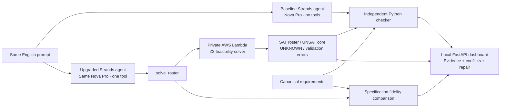

# One tool, three kinds of evidence

The checker and fidelity comparison are dashboard infrastructure, not tools exposed to either agent. Only the upgraded agent can invoke `solve_roster`. Lambda is accessed using IAM; it has no public function URL. Recorded runs remain labelled REPLAY with their original timestamps.
